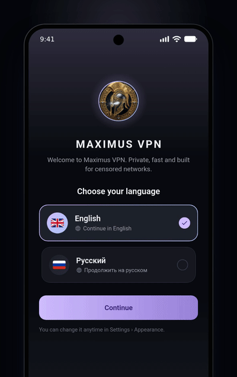
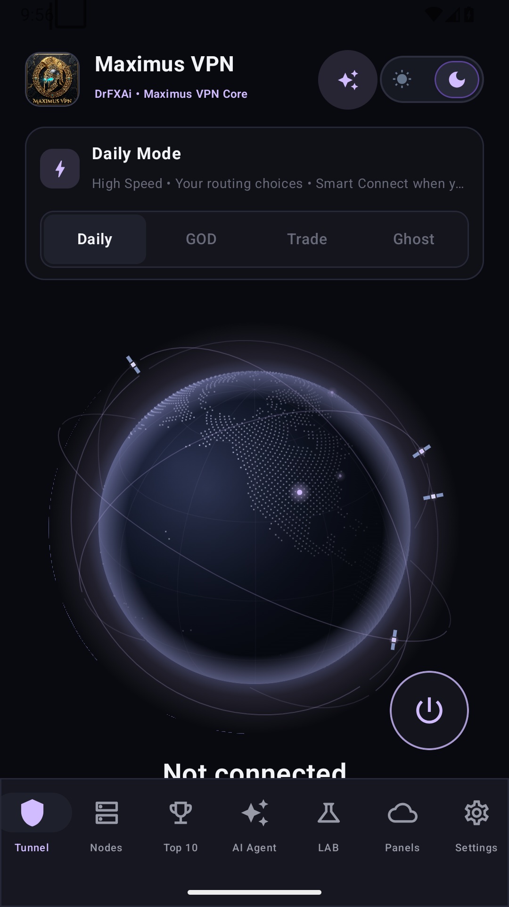
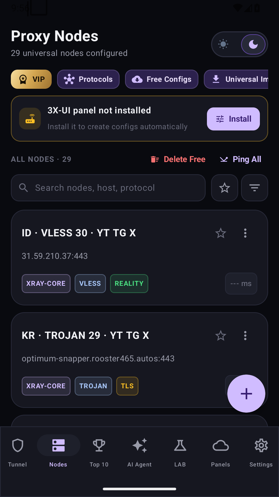
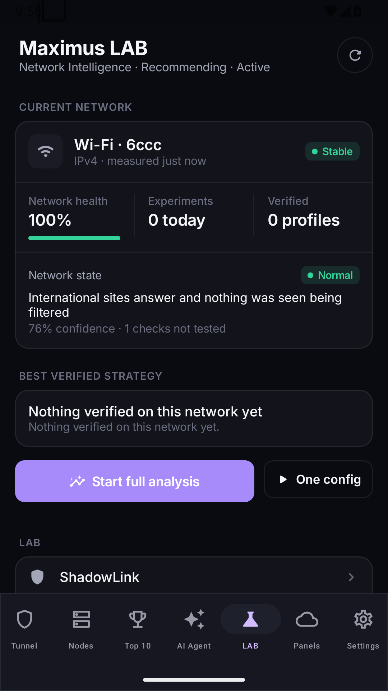
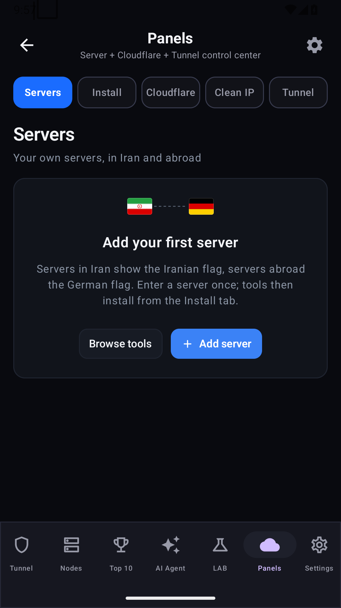

[English](README.md) | [Русский](README.ru.md) | **فارسی**

# MAXIMUS VPN

**جعبه‌ابزار شبکه برای اندروید؛ اتصال، بررسی و بازیابی مسیر، همه در یک جا.**

### [دانلود نسخهٔ V1.0.4 برای اندروید ↗](https://github.com/drfxai/MAXIMUS-VPN/releases/tag/V1.0.4)

Smart Connect · Network LAB · یافتن IP تمیز · ابزارهای سرور اختصاصی

## انتخاب زبان

MAXIMUS در اولین اجرا، پیش از هر مرحلهٔ دیگری از آشنایی با برنامه، زبان رابط را می‌پرسد: **English**، **Русский** یا **فارسی**. هر زمان بخواهید می‌توانید زبان را از **Settings › Appearance** (تنظیمات › ظاهر) تغییر دهید؛ در اندروید ۱۳ و بالاتر، MAXIMUS در تنظیم زبان برنامه‌های خود سیستم هم فهرست می‌شود.

پیش‌نمایش متحرک صفحهٔ اولین اجرا · <a href="docs/assets/language-picker-demo.mp4">مشاهدهٔ فایل MP4</a>

## برنامه را ببینید

تصاویر زیر نماگرفت‌های واقعی از APK منتشرشدهٔ **V1.0.2** روی اندروید ۱۵ هستند. برنامه تازه نصب شده، فهرست عمومی نودهایی که خود برنامه ارائه می‌کند نمایش داده می‌شود و هیچ تونلی فعال نیست. هیچ حساب خصوصی، پروفایل کاربر یا نتیجهٔ اتصال ساختگی به تصاویر اضافه نشده است.

<table>
<tr>
<td align="center" width="25%"> <b>Tunnel</b> فضای کار اتصال شما</td>
<td align="center" width="25%"> <b>Nodes</b> پروفایل‌ها و اشتراک‌ها</td>
<td align="center" width="25%"> <b>Network LAB</b> اول بسنجید، بعد انتخاب کنید</td>
<td align="center" width="25%"> <b>Panels</b> ابزارهای زیرساخت شما</td>
</tr>
</table>

[جزئیات تصویربرداری](docs/media/screenshots/capture.json) · [گالری رسانه](docs/media/README.md)

## ساخته‌شده برای شبکه‌های متغیر

| بخش | آنچه MAXIMUS ارائه می‌دهد |
| :--- | :--- |
| **Smart Connect** | مسیرهای مجاز را با درخواست واقعی و بررسی دوباره امتحان می‌کند و روش بازیابی را با وضعیت اندازه‌گیری‌شدهٔ شبکه تطبیق می‌دهد. |
| **حالت Unlock** | DNS ضدتحریم بدون نیاز به کانفیگ: با سرورهایی که سلامتشان بررسی می‌شود، سرویس‌هایی که کاربران ایرانی را تحریم کرده‌اند (Gemini، AI Studio و APIهای OpenAI) در دسترس می‌شوند. فقط DNS عوض می‌شود؛ برای سایت‌های فیلترشده همچنان تونل لازم است. [جزئیات](docs/UNLOCK_DNS.md) |
| **Network LAB** | عیب‌یابی شبکه، آزمایش کانفیگ‌ها، بررسی سرویس‌ها و شواهد لازم برای انتخاب مسیر. |
| **یافتن IP تمیز** | با زمان پاسخ TCP فهرست کوتاهی از نشانی‌ها می‌سازد و سپس نامزدها را با کانفیگ واقعی می‌سنجد. |
| **موتورهای متعدد** | هسته‌های Xray، sing-box و Mihomo؛ Psiphon و شیر و خورشید (Shir o Khorshid)؛ Lantern؛ Tor (پل‌های Snowflake و lyrebird)؛ WARP از طریق Aether (WireGuard، MASQUE، HTTP/2 در Matrix Transport و QUIC)؛ دسترسی مستقیم Serverless؛ تونل‌های DNS (dnstt، Slipstream و CottenDNS)؛ ByeDPI، AmneziaWG و SOAR. |
| **زیرساخت شما** | نصب 3X-UI، گردش‌کارهای Cloudflare/BPB، ورود کانفیگ و مدیریت سرور. |
| **کنترل اتصال** | تنظیمات DNS و مسیریابی، عیب‌یابی، کنترل تغییر مسیر (failover) و یکپارچگی با Always-on VPN اندروید. |

### مسیر بهتری پیدا کنید

پشتیبانی از هر ترنسپورت به موتور و کانفیگ بستگی دارد. **WARP روی TCP از HTTP/2 در Aether / Matrix Transport استفاده می‌کند؛ WireGuard روی UDP کار می‌کند.** Psiphon به تنظیمات شبکهٔ معتبر نیاز دارد و پل‌های Tor و تونل‌های DNS به زیرساخت در دسترس نیاز دارند. وجود یک موتور در برنامه یا موفقیت دست‌دهی (handshake) به‌تنهایی ثابت نمی‌کند که روی شبکهٔ شما به اینترنت دسترسی دارید. [راهنمای موتورها](docs/SMART_CONNECT_ENGINE_RECOVERY.md) را ببینید.

## شروع کار

1. فایل APK نسخهٔ V1.0.4 را از [صفحهٔ رسمی انتشار](https://github.com/drfxai/MAXIMUS-VPN/releases/tag/V1.0.4) دانلود کنید.
2. در بخش **Nodes** یک پروفایل یا اشتراک وارد کنید، یا زیرساخت خودتان را در بخش **Panels** پیکربندی کنید.
3. بخش **Tunnel** را باز کنید، پروفایل را انتخاب کنید و متصل شوید. هر وقت مسیری نیاز به بررسی داشت، از **LAB** استفاده کنید.

| دانلود | این را انتخاب کنید اگر… |
| :--- | :--- |
| [ARM64 APK](https://github.com/drfxai/MAXIMUS-VPN/releases/download/V1.0.4/MAXIMUSVPN-V1.0.4-arm64-v8a.apk) | گوشی اندرویدی جدید با پردازندهٔ ARM64 دارید. برای بیشتر کاربران پیشنهاد می‌شود. |
| [Universal APK](https://github.com/drfxai/MAXIMUS-VPN/releases/download/V1.0.4/MAXIMUSVPN-V1.0.4-universal.apk) | به پشتیبانی ARM32 یا x86_64 نیاز دارید، یا از نوع دستگاه خود مطمئن نیستید. |
| [`SHA256SUMS`](https://github.com/drfxai/MAXIMUS-VPN/releases/download/V1.0.4/SHA256SUMS) | می‌خواهید صحت فایل‌های دانلودشده را بررسی کنید. |

حداقل **اندروید ۷٫۰** لازم است. برای به‌روزرسانی، APK رسمی را روی نسخهٔ فعلی نصب کنید و از پروفایل‌های خود نسخهٔ پشتیبان نگه دارید. برای محافظت در زمانی که برنامه اجرا نیست، گزینه‌های **Always-on VPN** و **Block connections without VPN** اندروید را فعال کنید.

## مستندات

- [مرکز مستندات](docs/README.md) — راهنماهای کاربر، موتورها و زیرساخت (به انگلیسی).
- [ساخت از سورس](docs/BUILDING.md) — ابزارهای ساخت، runtimeهای نیتیو و اعتبارسنجی.
- [مشارکت](CONTRIBUTING.md) — گزارش خطا (Issues)، تغییرات متمرکز و بررسی‌ها.
- [سیاست امنیتی](SECURITY.md) — محدودیت‌ها و گزارش خصوصی آسیب‌پذیری.
- [اعلان‌های اجزای جانبی](THIRD_PARTY_NOTICES.md) — اجزای upstream و الزامات سورس.

## مجوز و پشتیبانی

کد برنامهٔ MAXIMUS VPN که متعلق به DrFX است تحت [GNU Affero General Public License v3.0](LICENSE) (AGPL-3.0-only) ارائه می‌شود. اجزای جانبی مجوزهای خود را که در [THIRD_PARTY_NOTICES.md](THIRD_PARTY_NOTICES.md) فهرست شده‌اند حفظ می‌کنند.

خطاهای قابل بازتولید را از طریق [Issues](https://github.com/drfxai/MAXIMUS-VPN/issues) گزارش کنید. توکن‌ها، کلیدهای خصوصی، نشانی‌های اشتراک و اطلاعات ورود سرور را از گزارش حذف کنید. برای آسیب‌پذیری‌ها مطابق [SECURITY.md](SECURITY.md) عمل کنید.

**MAXIMUS VPN · DrFXAi**

شبکهٔ شما، کنترل شما.

[دانلود](https://github.com/drfxai/MAXIMUS-VPN/releases/tag/V1.0.4) · [English](README.md) · [Русский](README.ru.md) · [مستندات](docs/README.md)

