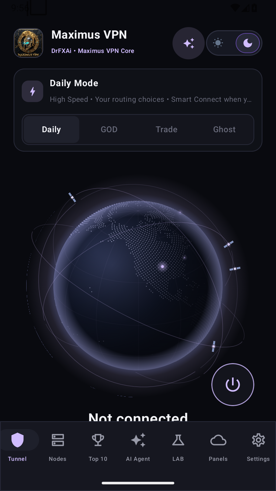
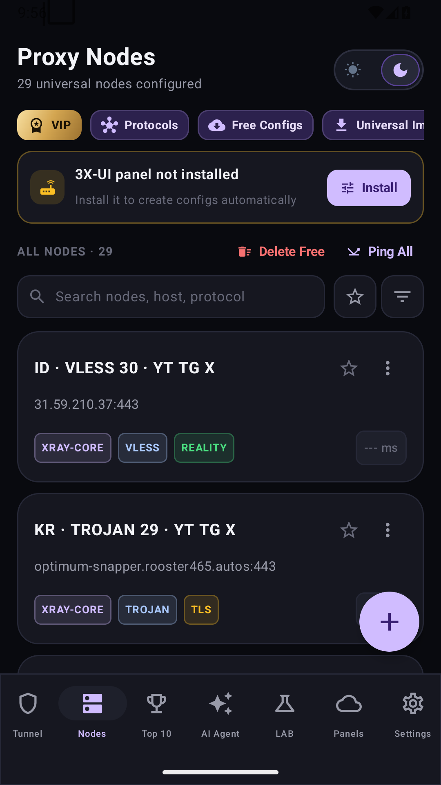
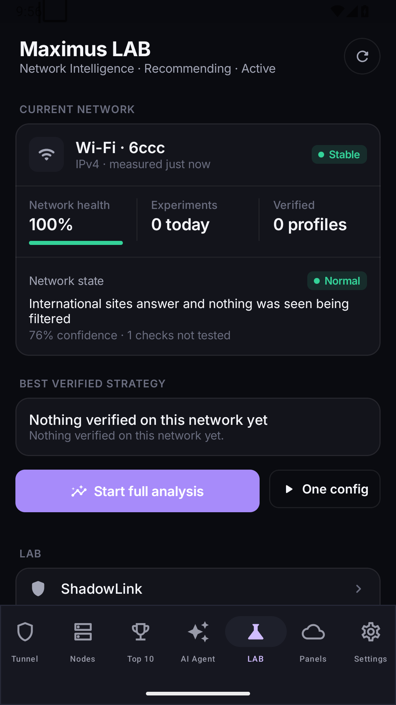
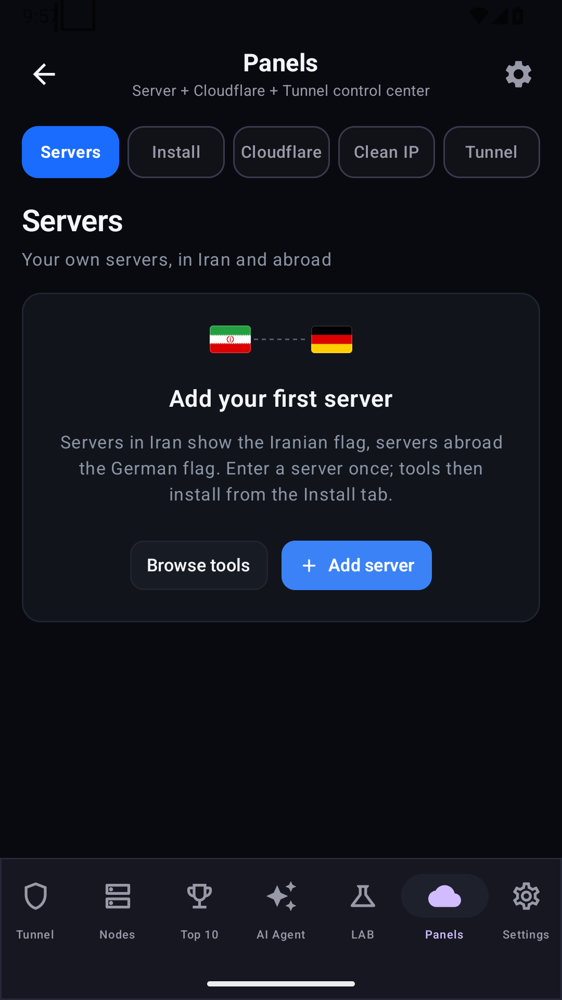

# MAXIMUS VPN

**An Android network toolkit. One place to connect, investigate and recover.**

[English](README.md) · [فارسی](README.fa.md)

### [Download for Android ↗](https://github.com/drfxai/MAXIMUS-VPN/releases/latest)

Smart Connect · Network LAB · Clean IP discovery · Private server tools

## See the app

Actual captures of the published **V1.0.2** APK on Android 15. These show a clean installation with the app-provided public node list and no active tunnel. No private accounts, user-supplied profiles or invented connection results have been added.

<table>
<tr>
<td align="center" width="25%"> <b>Tunnel</b> Your connection workspace</td>
<td align="center" width="25%"> <b>Nodes</b> Profiles and subscriptions</td>
<td align="center" width="25%"> <b>Network LAB</b> Measure before choosing</td>
<td align="center" width="25%"> <b>Panels</b> Your infrastructure tools</td>
</tr>
</table>

[Capture details](docs/media/screenshots/capture.json) · [Media gallery](docs/media/README.md)

## Built for changing networks

| Explore | What MAXIMUS provides |
| :--- | :--- |
| **Smart Connect** | Tries eligible paths with real requests and rechecks; adapts recovery choices to measured network conditions. |
| **Network LAB** | Network diagnosis, configuration experiments, service checks and evidence for choosing a route. |
| **Clean IP discovery** | Uses TCP timing to shortlist addresses, then validates candidates with the actual configuration. |
| **Multiple engines** | Xray, Mihomo, Psiphon, Tor, WARP/MASQUE, Matrix Transport, dnstt and Slipstream adapters. |
| **Your infrastructure** | 3X-UI installation, Cloudflare/BPB workflows, configuration import and server management. |
| **Connection controls** | DNS and routing settings, diagnostics, failover controls and Android Always-on VPN integration. |

### Find a better path

Transport support depends on the engine and configuration. **WARP over TCP uses Matrix Transport HTTP/2; WireGuard uses UDP.** Psiphon requires valid network settings; Tor bridges and DNS tunnels need reachable infrastructure. A bundled engine or successful handshake alone does not prove internet access on your network. See the [engine guide](docs/SMART_CONNECT_ENGINE_RECOVERY.md).

## Get started

1. Download the APK from [official Releases](https://github.com/drfxai/MAXIMUS-VPN/releases/latest).
2. Import a profile or subscription in **Nodes**, or configure your own infrastructure in **Panels**.
3. Open **Tunnel**, choose a profile and connect. Use **LAB** when a route needs investigation.

| Download | Choose this when… |
| :--- | :--- |
| [ARM64 APK](https://github.com/drfxai/MAXIMUS-VPN/releases/latest) | You use a modern ARM64 Android phone. Recommended for most users. |
| [Universal APK](https://github.com/drfxai/MAXIMUS-VPN/releases/latest) | You need ARM32 or x86_64 support, or are unsure about your device. |
| `SHA256SUMS` | You want to check the downloaded files. |

Android **7.0 or later** is required. To update, install the official APK over your current installation. Keep your profiles backed up. For protection when the app is not running, configure Android **Always-on VPN** and **Block connections without VPN**.

## Documentation

- [Documentation hub](docs/README.md) — user guides, engines and infrastructure.
- [Build from source](docs/BUILDING.md) — toolchains, native runtimes and validation.
- [Contributing](CONTRIBUTING.md) — issues, focused changes and checks.
- [Security policy](SECURITY.md) — limitations and private vulnerability reports.
- [Third-party notices](THIRD_PARTY_NOTICES.md) — upstream components and source requirements.

## License & support

MAXIMUS VPN is **source-available**, under a non-commercial license requiring prior permission for use of the source. It is not offered under a standard open-source license. Read [LICENSE](LICENSE) before copying, modifying, building or redistributing it. Third-party components retain their own licenses.

Report reproducible bugs through [Issues](https://github.com/drfxai/MAXIMUS-VPN/issues). Remove tokens, private keys, subscription URLs and server credentials from reports. For vulnerabilities, follow [SECURITY.md](SECURITY.md).

**MAXIMUS VPN · DrFXAi**

Your network. Your control.

[Download](https://github.com/drfxai/MAXIMUS-VPN/releases/latest) · [فارسی](README.fa.md) · [Documentation](docs/README.md)

