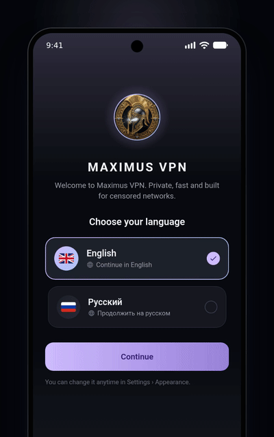
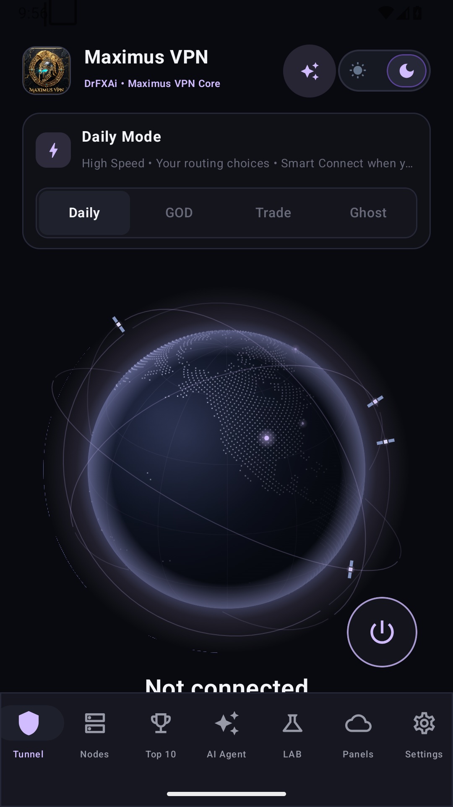
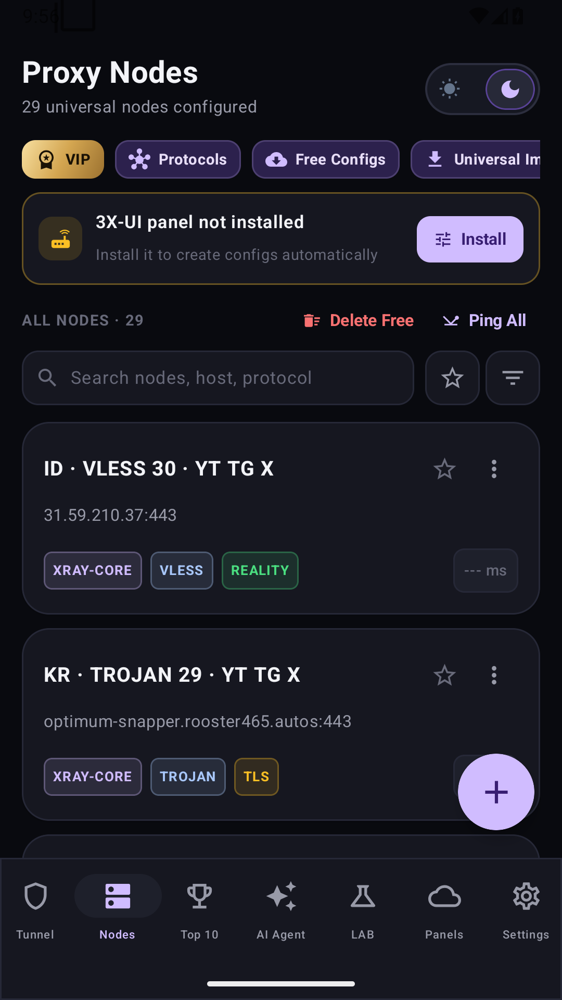
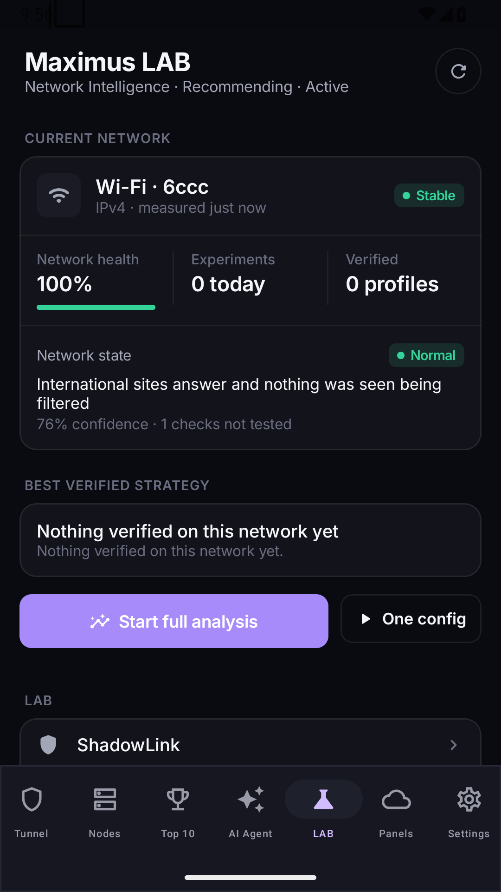
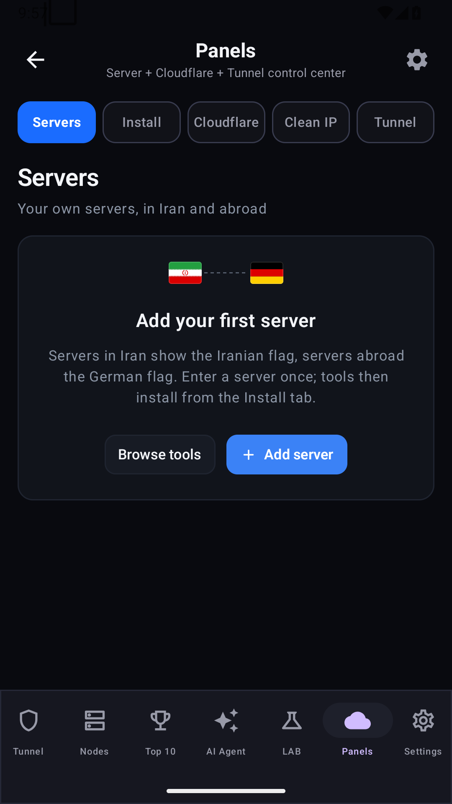

[English](README.md) | **Русский** | [فارسی](README.fa.md)

# MAXIMUS VPN

**Сетевой инструментарий для Android. Подключение, диагностика и восстановление — в одном месте.**

### [Скачать для Android ↗](https://github.com/drfxai/MAXIMUS-VPN/releases/latest)

Smart Connect · Network LAB · Поиск чистых IP · Инструменты для собственных серверов

## Выбор языка

При первом запуске MAXIMUS предлагает выбрать язык — **English** или **Русский** — ещё до остальных шагов знакомства с приложением. Сменить язык можно в любой момент в разделе **Настройки › Оформление**; на Android 13+ MAXIMUS также доступен в системной настройке языка приложений.

Анимированный пример экрана первого запуска · <a href="docs/assets/language-picker-demo.mp4">Смотреть MP4</a>

## Как выглядит приложение

Реальные снимки экрана опубликованного APK **V1.0.2** на Android 15. Показана чистая установка со встроенным в приложение публичным списком узлов и без активного туннеля. Никаких личных аккаунтов, пользовательских профилей или выдуманных результатов подключения не добавлено.

<table>
<tr>
<td align="center" width="25%"> <b>Tunnel</b> Рабочее пространство подключения</td>
<td align="center" width="25%"> <b>Nodes</b> Профили и подписки</td>
<td align="center" width="25%"> <b>Network LAB</b> Сначала измерьте, потом выбирайте</td>
<td align="center" width="25%"> <b>Panels</b> Инструменты для вашей инфраструктуры</td>
</tr>
</table>

[Подробности съёмки](docs/media/screenshots/capture.json) · [Галерея медиа](docs/media/README.md)

## Создан для меняющихся сетей

| Возможность | Что даёт MAXIMUS |
| :--- | :--- |
| **Smart Connect** | Проверяет подходящие маршруты реальными запросами и повторными проверками; подстраивает восстановление под измеренное состояние сети. |
| **Режим Unlock** | DNS против санкций без конфигурации: проверенные серверы открывают сервисы, блокирующие пользователей из Ирана (Gemini, AI Studio, API OpenAI). Меняется только DNS, для заблокированных сайтов по-прежнему нужен туннель. [Подробнее](docs/UNLOCK_DNS.md) |
| **Network LAB** | Диагностика сети, эксперименты с конфигурациями, проверка сервисов и данные для выбора маршрута. |
| **Поиск чистых IP** | Отбирает адреса по времени отклика TCP, затем проверяет кандидатов с реальной конфигурацией. |
| **Несколько движков** | Адаптеры Xray, Mihomo, Psiphon, Tor, WARP/MASQUE, Matrix Transport, dnstt и Slipstream. |
| **Ваша инфраструктура** | Установка 3X-UI, сценарии Cloudflare/BPB, импорт конфигураций и управление серверами. |
| **Управление подключением** | Настройки DNS и маршрутизации, диагностика, управление переключением маршрутов и интеграция с постоянным VPN (Always-on VPN) Android. |

### Найдите маршрут получше

Поддержка транспорта зависит от движка и конфигурации. **WARP поверх TCP использует HTTP/2 через Matrix Transport; WireGuard работает по UDP.** Psiphon требует корректных сетевых настроек; мостам Tor и DNS-туннелям нужна доступная инфраструктура. Наличие движка в приложении или успешное рукопожатие сами по себе не доказывают, что в вашей сети есть доступ в интернет. См. [руководство по движкам](docs/SMART_CONNECT_ENGINE_RECOVERY.md).

## Начало работы

1. Скачайте APK со страницы [официальных релизов](https://github.com/drfxai/MAXIMUS-VPN/releases/latest).
2. Импортируйте профиль или подписку в разделе **Nodes** либо настройте собственную инфраструктуру в разделе **Panels**.
3. Откройте **Tunnel**, выберите профиль и подключитесь. Если маршрут нужно исследовать, используйте **LAB**.

| Файл | Выбирайте, если… |
| :--- | :--- |
| [ARM64 APK](https://github.com/drfxai/MAXIMUS-VPN/releases/latest) | У вас современный телефон на Android с ARM64. Рекомендуется большинству пользователей. |
| [Universal APK](https://github.com/drfxai/MAXIMUS-VPN/releases/latest) | Нужна поддержка ARM32 или x86_64, или вы не уверены, какое у вас устройство. |
| `SHA256SUMS` | Вы хотите проверить скачанные файлы. |

Требуется Android **7.0 или новее**. Для обновления установите официальный APK поверх текущей версии. Храните резервные копии своих профилей. Чтобы трафик был защищён, даже когда приложение не запущено, включите в Android **Always-on VPN** и **Block connections without VPN** («Постоянная VPN» и «Блокировать соединения без VPN»).

## Документация

- [Центр документации](docs/README.md) — руководства пользователя, движки и инфраструктура (на английском).
- [Сборка из исходников](docs/BUILDING.md) — инструменты сборки, нативные среды выполнения и проверка.
- [Участие в разработке](CONTRIBUTING.md) — issues, точечные изменения и проверки.
- [Политика безопасности](SECURITY.md) — ограничения и приватные сообщения об уязвимостях.
- [Сторонние компоненты](THIRD_PARTY_NOTICES.md) — компоненты из upstream и требования к исходному коду.

## Лицензия и поддержка

Код приложения MAXIMUS VPN, принадлежащий DrFX, распространяется по лицензии [GNU Affero General Public License v3.0](LICENSE) (AGPL-3.0-only). Сторонние компоненты сохраняют свои лицензии, перечисленные в [THIRD_PARTY_NOTICES.md](THIRD_PARTY_NOTICES.md).

О воспроизводимых ошибках сообщайте через [Issues](https://github.com/drfxai/MAXIMUS-VPN/issues). Удаляйте из отчётов токены, приватные ключи, адреса подписок и учётные данные серверов. Об уязвимостях сообщайте согласно [SECURITY.md](SECURITY.md).

**MAXIMUS VPN · DrFXAi**

Ваша сеть. Ваш контроль.

[Скачать](https://github.com/drfxai/MAXIMUS-VPN/releases/latest) · [English](README.md) · [فارسی](README.fa.md) · [Документация](docs/README.md)

