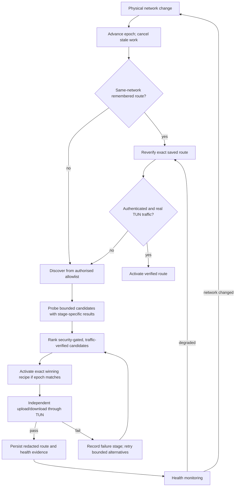

# ADR — Exact-route discovery, verification and network-scoped replay

- **Status:** Proposed; **not approved or implemented** by adding this document.
- **Date:** 2026-10-17
- **Scope:** MAXIMUS VPN Android route discovery, connection recovery and post-connect validation.
- **Related research:** [Connectivity resilience register](../connectivity-research-2026-10-17.md)
- **Existing behavior:** [Connectivity semantics](../CONNECTIVITY.md), [Network state](../MAXIMUS_NETWORK_STATE.md), [MASQUE](../MAXIMUS_MASQUE.md).

## Problem

A protocol name or successful TLS/QUIC/DNS handshake cannot tell us whether a **particular full route** works on the current physical network. The same profile may succeed only with one endpoint IP, Host/SNI, ALPN, Fragment profile, resolver set and MTU. Replaying just the transport name loses the successful evidence. An old scan must never replace a newer choice after the user changes network.

MAXIMUS already has `ServerRace`, `LiveTunnelProbe`, `NetworkMemory`, `MtuIntelligence`, `FragmentProfileEngine`, `ShadowLink` and sidecars. The proposed change **extends and composes** those components; it is not a mandate to duplicate their functionality.

## Proposed decision

Make a versioned, immutable **RouteRecipe** the unit of probe, verification and memory. Create a new `networkEpoch` for every relevant physical-network change, so any pending probe from an earlier epoch is cancelled or ineligible to win. A candidate is promoted to `lastVerified` only when the required real traffic has passed through the intended TUN and mandatory authentication/security gates are met. Under enhanced acceptance tests, require both upload and download, not just a response to an HTTP GET.

### Proposed minimal schema (illustrative; not current Kotlin API)

```text
RouteRecipe {
  schemaVersion, routeId, networkContextId, networkEpoch,
  transport, engineId, profileReference,
  endpointIp, endpointPort, host, sni,
  requestedAlpn[], negotiatedAlpn?,
  ech: { mode, configSourceReference?, observedResult?, failureStage? },
  fragment: { enabled, engineSpecificSettings, exceptionReason? },
  mtu: { tunConfigured, transportWorking?, pathEstimate? },
  resolvers: [{ resolverReference, lastObservedHealth? }],
  security: { certificateValidationRequired: true, pinReference? },
  transportParameters, expiry, verificationEvidence
}
```

**Do not store passwords, Trojan credentials, SOCKS auth, full sensitive WS paths, private keys, unredacted subscriptions, identifying Wi-Fi details or user secrets in the research/telemetry store.** The active profile can keep sensitive connection configuration in the existing protected user storage. A remembered recipe stores a stable reference and non-secret derived parameters. Certificate/public pin material is separate from private enrollment/identity material.

### Proposed state machine



For an engine that cannot expose reliable simultaneous upload/download within the initial connection deadline, report `connected_traffic_verified_partial` versus `bidirectional_verified` in diagnostics rather than silently claiming the stronger proof.

## Security and privacy invariants

1. Production automatic routing cannot turn off certificate validation, `allowInsecure` safeguards, established MASQUE pins, DNS/IPv6 containment or packet guard/kill switch. If Android lockdown is not enabled, explain the OS-level limit; never claim full-device fail-closed isolation.
2. ECH status is not boolean. Observe `not_configured`, `offered_not_accepted`, `accepted`, `failed`, or `unknown_unobservable` as supported by the TLS implementation. A URL-encoded ECH parameter alone establishes nothing about negotiation.
3. Endpoint discovery may change the **physical** IP/port only under configured authorisation; logical Host, SNI and cryptographic peer identity must remain correct. Never use arbitrary domains, Internet-wide sweeps or discovered third-party targets without authorisation.
4. On `networkEpoch` change, cancel old probes and prevent their completion handlers from committing winners or changing active routing.
5. MASQUE enrollment state and the entire `Retry-After` cooldown (including after restart) must be persisted before reattempt. Keep private keys in protected storage, referenced by alias. Do not claim implemented for the existing H3 sidecar.
6. Maintain deterministic backoff and bounded concurrency; no unlimited retries, background battery drain or forceful disconnection of a healthy working tunnel just to probe an alternative.
7. Screen-changing app-specific actions and routing changes remain separate from experimental network probes. Do not let remote research content mutate profiles automatically.

## Compatibility and migration

- Current `NetworkMemory` uses per-carrier or generic Wi-Fi names and stores *kinds and variant keys*. Preserve readable legacy data while introducing an opt-in recipe layer, with a versioned schema. On generic Wi-Fi, a stored route is a **candidate**, not per-access-point proof.
- Current `MtuIntelligence` already uses a bounded ladder with `PROPOSED → STAGED → VERIFIED → COMMITTED`; reuse it. Preserve separation between TUN MTU, estimated physical path MTU (not yet measured) and proven transport MTU.
- Current `FragmentProfileEngine` already tracks experiments; keep engine-specific structures. Mihomo's `maxSplit=0→256` migration is not automatically an Xray migration. Restore selection on Activity recreation and after process restart.
- For `workers.dev`, baseline with an **unfragmented ClientHello**; consider alternative controlled Fragment trials only where tested. Do not turn off standard TLS validation to recover.
- Existing `SlipstreamSidecar` is registered as bundled. It should not be counted as physical-network verified merely because the native process or SOCKS port opens. A profile with no validated peer certificate may be flagged unverified and should be ineligible for automatic trusted-route promotion.
- Existing `MasqueSidecar` provides H3 only. H2 support requires a separately validated engine/adapter, not changing a string from `h3` to `h2`.

## Verification contract by route type

| Route | Minimum admissible evidence | Stronger acceptance | Special failure categories |
| --- | --- | --- | --- |
| Trojan/VMess/VLESS WS TLS | Validated TLS, correct host/SNI, real HTTP request through active route | Upload and download, verified ALPN/ECH observation, old/new endpoint A/B | `tcp`, `tls`, `cert`, `ech`, `ws_upgrade`, `traffic` |
| MASQUE H3 | Authorised enrolled/pinned QUIC session and tunnel traffic | Upload/download + addresses + exit-IP evidence | `udp`, `quic`, `pin`, `enrollment`, `429`, `traffic` |
| MASQUE H2 (future) | Pin-verified TLS+HTTP/2 session and real tunneled data | Independent bidirectional checks and restart validation | `tls`, `alpn`, `pin`, `h2_session`, `traffic` |
| Slipstream/DNSTT/CottenDNS | Correct controlled tunnel domain, authorised resolver, authenticated tunnel plus app traffic via TUN | Multipath per-resolver loss measurements, upload/download hashes | `recursive_dns`, `truncation`, `resolver_timeout`, `peer_auth`, `traffic` |
| WireGuard/AWG | Authenticated peer handshake plus traffic through TUN | Independent app upload/download and scoped MTU A/B | `udp`, `handshake`, `mtu`, `traffic` |

Measure actual transport upload and download (nonce payload or controlled echo destination) before promoting to `BIDIRECTIONAL_VERIFIED`. A probe to a known website can fail for unrelated filtering even when the VPN route is valid; use at least two controlled, independent verification targets where possible and record `not_tested` when neither is reachable. A connectivity test through the current tunnel must not be attributed to another queued profile.

## Candidate rollout and test plan

**Stage A — model-only:** add versioned recipe serialization and migration tests. Verify redaction, invalid fields, UTF-8/IDN host handling, per-engine parser limits, no credential exposure in logs, expiration, and older-epoch rejection. No production route changes.

**Stage B — bounded observer:** generate candidate recipes from existing successful `ServerRace`/`FragmentProfileEngine`/`MtuIntelligence` evidence in LAB only. Compare stored intent with actual ALPN/ECH/MTU observations; never relabel a `NOT_TESTED` status as failed or successful.

**Stage C — opt-in recovery:** revalidate a remembered candidate for the current physical network. Preserve the existing healthy connection; promote only when mandatory proof passes and same epoch still holds. Assert rollback on failure, app process death and rapid Wi-Fi↔cellular transitions.

**Stage D — physical acceptance:** real Android 7+ supported ABI, Android 15/16 foreground-service lifecycle, high packet loss, 429 Retry-After, no-UDP, DNS-only, TCP TLS filtered, IPV6-only/dual stack, SNI filtered and Cloudflare Worker no-fragment cases. Collect sanitized route receipts and explicit non-leak tests. Never conflate a workstation's upstream test with MAXIMUS on an affected operator.

**Stage E — rollout:** behind a reversible feature flag after CI and physical acceptance; no public version bump or release until separately authorised.

## Alternatives considered

- **Remember transport only:** too coarse; loses endpoint, ECH, Fragment, MTU and TLS identity that determined success.
- **Force Fragment + MTU 1280 globally:** can break Worker ClientHello and good paths, obscures field observations and confuses TUN versus path MTU.
- **Treat socket/tunnel handshake as success:** produces false connected UI and can misroute user traffic. Existing `CONNECTIVITY.md` explicitly rejects this shortcut.
- **Add many new engines before validating current ones:** multiplies attack surface, battery demand and maintenance cost; priority is evidence and replay of the already present engines.

## Decision gate

This ADR remains **proposed** until a code review accepts it, confirms license compatibility, tests its migration and fail-closed behavior, and supplies real-device results. Its presence in `docs/` is not approval to auto-change profiles, to disable TLS checks, or to publish an APK.
