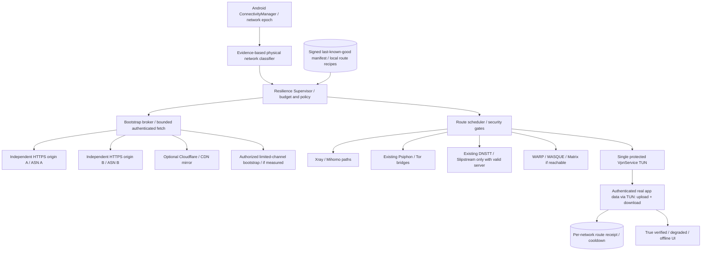

# ADR: MAXIMUS Extreme-Filtering Resilience (Iran scenario)

**Status:** PROPOSED — architecture and acceptance plan only (not implemented, not field-verified).  
**Date:** 2026-10-23  
**Target:** MAXIMUS VPN Android, without changing the official released APK, version, signing identity, or user's saved configurations.  
**Related:** [Connectivity semantics](../CONNECTIVITY.md), [Network state](../MAXIMUS_NETWORK_STATE.md), [Smart Connect engine recovery](../SMART_CONNECT_ENGINE_RECOVERY.md), [Official signed subscriptions](../SUBSCRIPTIONS.md), [Adaptive route validation](adaptive-route-validation.md), [Connectivity research](../connectivity-research-2026-10-17.md).

## 1. Scope and reality constraints

Engineer for a handset in Iran on MCI, Irancell, fixed-line Wi-Fi or another carrier, potentially with Cloudflare blocked, DNS tampering, TLS/SNI resets, packet-size-dependent stalling, failed UDP/QUIC, a domestic-only network or no verified international egress.

**No software-only VPN can restore global reachability across a genuine physical or administrative international isolation if no permitted outbound or independent bearer exists.** A reachable domestic host is not an international relay unless that host itself has a verified, authorized international egress. A DNS answer, TCP/TLS handshake, process startup, SOCKS port, QUIC version reply or country-wide outage report does not prove a usable full-tunnel connection.

Safety invariant: do not silently bypass Android lockdown, weaken TLS verification, accept unsigned or rolled-back new manifests, invent network health, leak DNS/IPv6, or replace a known-good route based only on handshakes.

## 2. Existing MAXIMUS baseline — avoid duplicate work

Present or documented on `main` (source presence is **not** field validation):

- One Android `RayVpnService`, Always-on-capable; Xray/VLESS, Mihomo, Psiphon, Tor/lyrebird (including obfs4, WebTunnel, Snowflake, meek), WARP WireGuard and MASQUE, Matrix Transport, DNSTT and Slipstream families.
- LAB measurements and a `NetworkStateTracker`; security-gated derived config experiments; real-request verification; network memory and MTU/fragment experiments; packet guard and explicit Android lockdown guidance.
- Signed subscription envelopes, anti-rollback sequence, last-known-good local cache and optional independent HTTPS mirrors (`docs/SUBSCRIPTIONS.md`). **Current documentation also describes an unsigned fallback for builds with no configured official public key:** this needs a compatibility-aware migration policy, not a silent breaking change.
- Existing experiment limits and trade-mode behavior must be preserved. Do not infer an engine is ready merely because a sidecar is packaged.

**Priority gaps for this ADR:** independent control-plane distribution if Cloudflare and/or its Worker fails; trustworthy per-network, per-route receipts; authenticated bidirectional TUN proof on a physical device; distinguish domestic-only from true isolation without overclaiming; bounded low-data bootstrap; app and server failure-domain diversity; privacy and user safety during extreme censorship.

## 3. Threat model and failure domains

Threats: poisoned DNS, blocked or misleading IP responses, TCP resets, TLS/SNI/DPI interference, selective QUIC/UDP blocking, upload-only failure, IPv6 asymmetry, captive portals, carrier NAT changes, invalid server certificates, adversarial relays/configuration feeds, stale mirrors, MITM and clock manipulation, Android service process death, app traffic leak and high-volume probe fingerprints. Also include physical danger to a user from exposed diagnostics and conspicuous background activity.

Failure domains: (a) handset or Android VPN service; (b) mobile/fixed ISP last mile; (c) resolver and international transit; (d) CDN/provider/ASN; (e) relay and tunnel server; (f) configuration/control-plane publisher; (g) credentials and signatures. Diversity must cross providers/ASNs/hosting accounts, **not just hostnames on the same CDN**.

Model states as evidence, not absolute diagnoses:
- S0: healthy, authenticated, bidirectionally verified international egress.
- S1: partial international access; choose proven route, respect user's manual/trade pinning.
- S2: selective filtering or DNS/TLS/UDP interference; controlled candidate set.
- S3: primary provider or Cloudflare unavailable; use independently hosted authenticated path, not another hostname backed by the same provider.
- S4: domestic-only *suspected*; only attempt explicitly configured reachable domestic relay and/or genuinely verified limited-channel bootstrap. An Iranian VPS with no external egress is not a global exit.
- S5: no verified outbound path; provide transparent state and conserve battery/data while listening for network changes.
- S6: physical interface absent or Android blocks traffic; no outbound attempts. Only local display/import remains.

No detector should display "true isolation" as a provable national fact based on a single handset. Keep "NO_VERIFIED_EGRESS" and testing provenance.

## 4. Architecture (single system VPN, several eligible transport families)

The bootstrap plane is **not** the data plane. Low-throughput DNS-based bootstrap may retrieve small signed manifests if an authorized recursive resolver can reach the controlled zone; it does not imply a working general VPN tunnel. Domain fronting and cached/alternative addressing are opportunistic, not universal techniques. WebRTC/P2P requires discovery, signaling, return traffic and a peer with working egress; do not make it a P0 prerequisite.

### 4.1 Independent control plane

1. Operate two separate **non-Cloudflare** HTTPS origins using independent hosting networks/accounts, plus Cloudflare as an optional third path. Publish the same immutable signed manifest to all; do not build the non-Cloudflare mirrors by synchronously fetching from Cloudflare at client-request time.
2. Publisher writes manifest once, signs offline/in an isolated signer, then pushes copies independently. Atomic staged upload with content hash; version/sequence, expiry, key ID, signature, issuer and destination profile class. Mirrors cannot author content.
3. Reuse the existing ECDSA-P256 signed subscription envelope where possible. Add controlled signer-key rotation, trusted-key overlap, and explicit rollback rejection; do not let a failed remote fetch delete last-known-good local servers. Treat a device with an untrusted clock conservatively; never accept a newly fetched manifest whose signature, expiry or anti-rollback checks fail.
4. Keep **public bootstrap metadata** separate from VIP/user secrets. VIP entitlement must not be embedded in a universally shared offline package. Do not include connection passwords, subscriber identity or signing secrets in QR/share exports.
5. Optional offline transfer of a **signed, bounded, importable** public catalog over QR/file/Bluetooth/Nearby; validate with preinstalled trust root, ask for explicit confirmation, reject executable payloads and protect against archive bombs. This transfers data, **not Internet connectivity**.
6. Bootstrap Tier 0: verified cached route (zero fetch dependency). Tier 1: independent HTTPS + optional CDN with max two parallel bounded probes. Tier 2: eligible preconfigured alternate transport (existing bridges/Psiphon). Tier 3: authenticated DNS-tunnel/limited-channel **only when capability evidence exists**. Do not depend on a single public DNS provider (e.g. 8.8.8.8 or 1.1.1.1). A working DNS lookup alone is insufficient.

### 4.2 Route recipe / switch contract

Extend the proposed immutable route recipe ADR rather than inventing a second representation:
`network_epoch`, non-identifying `network_class`, engine version/hash, tunnel identity, endpoint IP/port, TLS hostname/Host/ALPN requested + negotiated, ECH requested + negotiated + unknown, fragment mode, TUN MTU versus *measured* path MTU, IPv4/v6 binding, DNS mode, certificate/pin verdict, verification-target IDs, sample time and expiry, upload/download proof, and bounded failure-stage taxonomy. **Never store secrets in telemetry or LAB snapshots.**

Routing rules:
- Hard filter by security and actual engine capability first; no unauthenticated route or invalid certificate candidate enters the scoring/race.
- Preserve healthy tunnel; do not flap on high RTT alone. Failed-then-recovered path requires explicit authenticated end-to-end recheck in the current network epoch.
- Score eligible candidates on recent bidirectional pass rate, robustness, latency/loss, data use and energy cost. Never let a high performance score override a failed security requirement.
- Allow max 2 concurrent light-weight bootstrap checks; use existing LAB budgets (e.g. 15 user/4 background, stricter metered/low-battery limits) rather than bypassing them. Exponential backoff with jitter and cool-down; pause scanning on suspected isolation.
- On Wi-Fi ↔ cellular changes, invalidate outstanding results from the old epoch, rebind and protect outbound engine sockets (`VpnService.protect()`), cancel stale startup processes, and retain last-known-good information as historical, not current proof.
- Manual/trading-pinned route: do not alter exit IP unexpectedly. Warn of outage; require user authorization for exit change.

### 4.3 Outcome semantics and UX

Only show `CONNECTED_VERIFIED` after authenticated tunnel plus successful real application traffic through the installed TUN. The stronger `BIDIRECTIONAL_VERIFIED` additionally requires bounded payload hash checks for upload and download and observation of the intended exit when available. A failure to reach an unrelated test site must be `UNKNOWN` or `PARTIAL`, not an automatic tunnel failure. Use two independently controlled, appropriately small probe destinations where possible.

Visible states: `CHECKING_LOCAL_NETWORK`, `FILTERING_SUSPECTED`, `CONTROL_PLANE_UNREACHABLE`, `RECOVERING_FROM_CACHE`, `CONNECTED_VERIFIED`, `DEGRADED`, `NO_VERIFIED_EGRESS`, `PHYSICAL_NETWORK_OFFLINE`. Present "last verified [time] on [network type]" and an optional user-run "Full analysis"; avoid scary unsupported claims of confirmed nationwide shutdown.

Provide a **Survival mode**: low-bandwidth minimal probes, lower battery drain, signed offline catalogs, opt-in retry when network changes, and separate deterministic "Emergency test" for user-initiated deep analysis. Never silently install/update a binary or copy community Telegram executable configs.

## 5. Data-path and Android safety requirements

- Exactly one owner of Android TUN; avoid simultaneous independent VPN services. Maintain process ownership, cancellation, fencing by network epoch, idempotent shutdown and no self-dial to the protected tunnel.
- Socket protection + underlying `Network` binding must be verified on Android 15; Android Always-on plus system "Block connections without VPN" is required for protection across application restarts. In-app packet guard alone cannot guarantee that boundary.
- DNS: encrypted or in-tunnel resolution where configured; no silent plaintext fallback; prevent IPv6 escape and DNS direct leak. Do not claim an unperformed third-party leak test passed.
- Certificate and hostname verification are mandatory; explicit pinned identity where specified. No global `allowInsecure`, public fallback identity, silent SNI changes, unauthorized scanning, spoofed credentials, or safety-critical AI actions.
- MTU is a controlled per-route A/B experiment; 1280 is a candidate only, not an ISP-wide constant. Distinguish TCP/UDP/MASQUE H2/H3 actual adapter capability and tested ALPN.
- New libraries: dependency/SBOM and CVE review; Lantern main app/Unbounded are GPL-3.0 while Kindling is Apache-2.0. **Do not copy GPL source into MAXIMUS's source-available distribution without legal review**; engineering concepts can be independently reimplemented.

## 6. Explicit scenario matrix and pass/fail requirements

| Case | Injected or observed condition | Expected behavior | Required proof |
|---|---|---|---|
| T01 | Primary Cloudflare hostname+ASN blocked | Non-CF signed origin tried; cached profile retained | Manifest signature, real non-CF source + TUN traffic |
| T02 | All remote configuration origins blocked, prior working recipe survives | Connect from cache; do not delete/replace servers | No fetch dependency, upload+download |
| T03 | DNS poisoned/NXDOMAIN hijack | Detect anomaly, do not trust forged answer; authenticated alternative only | Identity checks, no plaintext DNS leak |
| T04 | Foreign TLS reset/SNI interference | Distinguish network from credential/cert failures; controlled tests | Failure-stage evidence, secure TLS |
| T05 | UDP/QUIC suppressed but TCP survives | Skip incompatible UDP transport; try eligible TLS/TCP family | Correct actual negotiated transport + TUN traffic |
| T06 | TCP limited, authorized recursive DNS egress exists | Limited bootstrap may load signed config; full VPN only if verified | Resolver nonce proof + authenticated bidirectional tunnel |
| T07 | Domestic reachable, international routing unavailable | No fake global Connected; no promise from domestic VPS | Egress reachability and exit evidence |
| T08 | No usable physical bearer | Stop repeated expensive scans; show accurate local/offline status | Zero leak; low idle usage |
| T09 | IPv6-only or IPv4 blackholed | Correct route/address family; no IPv6 leak | A/B dual-stack tests |
| T10 | Upload stalls while download works / packet MTU blackhole | DEGRADED; bounded MTU A/B; no false bidirectional pass | Hash-checked upload and download |
| T11 | Wrong pin, expired/replayed manifest, clock rollback | Reject changes, preserve last-known-good, never trust replay | Signature/rollback test |
| T12 | Rapid Wi-Fi ↔ Irancell ↔ MCI handovers, process death | Stale results ignored; no direct escape / loop | Android lockdown, epoch fencing and service recovery |
| T13 | Existing healthy manual/trade route, backup is "faster" | Keep exit stable | Exit-IP invariant |
| T14 | Mirror shares Cloudflare origin/CDN under another hostname | Mark not independent, force diversity audit | Provider/ASN/origin inventory |
| T15 | Battery <20% or metered connection | Respect existing reduced test budget and consent | Probe/data and battery logs |
| T16 | Malicious QR/catalog/relay or unsafe community recommendation | Refuse unsigned config/code/executable and unauthorized identity change | Parser fuzzing, security gate |

## 7. Validation stages and numeric engineering targets (NOT measurements)

1. **Baseline audit:** confirm exact Kotlin wiring and sidecar binaries, license/SBOM, signing key availability in CI, mirror provenance and production rollout configuration. Documentation alone is not proof of a live deployment.
2. **Deterministic unit/property tests:** classifications with UNKNOWN vs FAIL, signature expiry/anti-rollback/key rotation, strict original-profile immutability, policy gates, stale epoch cancellation, retry/circuit breaker, no-signer build migration, parser fuzzing.
3. **Controlled fault laboratory:** simulate IP/ASN deny, DNS poison, SNI/TLS reset, server 429, packet loss/MTU blackhole, partial IPv6, non-CF origin loss, captive portal, app process kill and all-bearers unavailable. Capture end-to-end TUN evidence; do not claim carrier verification from a laptop or emulator.
4. **Physical acceptance:** Android 15 SM-F711B plus another supported Android handset; at least MCI, Irancell and two materially different Wi-Fi ISPs if accessible; IPv4/IPv6, charged/low battery, background/foreground, Always-on/lockdown; test at several real-world time windows and record date/operator/network type without identifiers. Participation must be voluntary and risk-aware.
5. **Security:** zero unencrypted DNS/IPv6/IP escape in supported strict mode; reject 100% of invalid signed catalogs in a defined negative-test corpus; no automatically promoted unverified path; no crash/ANR from simulated transport failures.
6. **Pilot metrics (targets):** `false_verified_connects=0`; `secrets_in_logs=0`; `unreviewed_exit_switches_in_trade_mode=0`; `stale_epoch_promotions=0`; no sustained retry storm while S5/S6; route remains operational when Cloudflare is individually blocked **if** at least one separately validated non-CF path is available. Measure time-to-first-bidirectional-byte, p50/p95 reconnect, data KB per recovery, CPU, battery drain, 24h reconnect stability, and per-operator pass rate. Set numerical latency/battery thresholds **after** baseline measurement; no invented SLA.
7. **Deployment gate:** PR code review, passing CI, on-device leakage/lockdown tests, signed update compatibility, reproducible evidence receipts, manual approval; canary feature flag with instant rollback. No change to release/version/signing unless separately authorized.

Field status as of this ADR: **NOT TESTED here**. User-provided Irancell diagnostics are a valuable observed failure, not a controlled carrier-wide reproduction.

## 8. Prioritized engineering backlog

- **P0-A:** inventory **actual** non-Cloudflare signed subscription origins, eliminate same-provider mirror dependence and validate secure frozen last-known-good on device. Add origin fault-injection tests and conservative signing-key migration.
- **P0-B:** implement a consolidated immutable `RouteReceipt` with current network epoch and authenticated upload/download through TUN; expose truthful UI evidence and evidence age.
- **P0-C:** verify Android lockdown, protected sockets, no IPv6/DNS leak, process death and rapid handover on a real physical device. Repair failures before broad engine additions.
- **P0-D:** integrate bounded `ResilienceSupervisor` over existing LAB and Smart Connect (no parallel unbudgeted scanning), with S0–S6 evidence, cool-down and safe cache reuse.
- **P1-A:** independently hosted signed manifest distribution with atomic publisher and key rotation, and optional signed offline import.
- **P1-B:** controlled owned-zone recursive DNS egress check and opt-in limited-bandwidth Kindling-inspired bootstrap; don't turn it on without server path, measured DNS recursion, security and cost review.
- **P1-C:** real physical validation of existing Psiphon, Tor, DNSTT/Slipstream, Matrix H2 and MASQUE H3 routes by family; mark missing infrastructure/capabilities as NOT TESTED.
- **P2:** voluntary P2P relay experiment with user safety, NAT/signaling feasibility, economics, abuse controls and license review. Not required for extreme filtering minimum viable resilience.

## 9. References

- MAXIMUS source documents linked at top; read them before implementing to preserve existing semantics.
- Lantern Kindling: https://github.com/getlantern/kindling (small-payload redundant bootstrap; Apache-2.0).
- Lantern Unbounded: https://github.com/getlantern/unbounded (P2P research; GPL-3.0).
- Tor bridge guidance: https://support.torproject.org/tor-browser/circumvention/unblocking-tor/
- Android VPN: https://developer.android.com/reference/android/net/VpnService
- Android Always-on/lockdown: https://developer.android.com/develop/connectivity/vpn
- IODA Iran Jan 2026 measurements: https://ioda.inetintel.cc.gatech.edu/reports/a-comparative-look-at-internet-shutdowns-in-iran-2019-2022-2026-and-2026/

**Decision:** defer production implementation and release until the P0 trust, connectivity-proof and no-leak gates are satisfied. This ADR is an actionable design document, not evidence of a tested connection or a shipped change.
